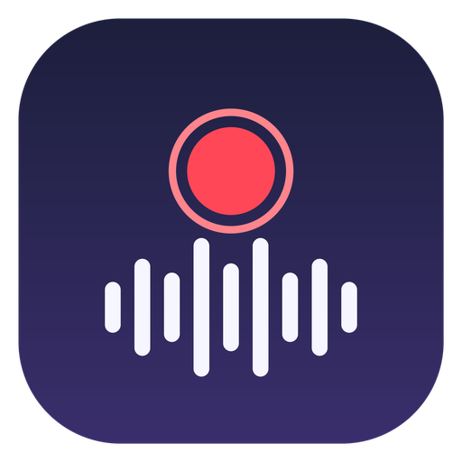

# Meet Recorder

Meet Recorder is a desktop app for macOS, Windows and Linux. Capture a screen or window, your
microphone and system audio where supported. When you stop, the app writes a **timestamped
transcript** and **AI meeting notes** with a summary, decisions, action items and open questions.

Use **your own OpenAI API key** for transcription and notes. The app sends requests directly to
OpenAI and saves recordings and Markdown files on your computer.

## Demo

[Watch the 29-second walkthrough](docs/demo/Meet-Recorder-Walkthrough.mp4) to see how a recording
becomes a timestamped transcript and structured notes. The walkthrough uses a simulated meeting.

[](docs/demo/Meet-Recorder-Walkthrough.mp4)

## Download

When installers are available, download them from the
[Releases page](https://github.com/radicalloop/meet-recorder/releases):

- **macOS**: `.dmg` (Apple Silicon and Intel)
- **Windows**: `-setup.exe` (x64 and arm64, per-user install, no admin needed)
- **Linux**: `.AppImage` (portable) or `.deb`

You can also [build from source](#development).

## First-run setup

1. Open **Settings** and paste your OpenAI API key (create one at
   <https://platform.openai.com/api-keys>). The app uses your OS credential store to encrypt the
   saved key where available. Settings displays a warning if the app stores it unencrypted.
2. Click **Start**, pick the screen or window showing your meeting, choose your microphone, and
   you're recording.
3. Click **Stop** when the meeting ends. The app transcribes the speech it captured,
   then writes the transcript and notes next to the recording.

Transcription runs after recording. Choose the transcription and notes models in **Settings**
using the models available to your API key.

### What it costs

OpenAI bills API usage to your account. Transcription costs depend on the selected model and the
amount of speech sent per channel. If both microphone and system audio pick up the same speech,
both may be billed. Generating notes adds a separate Responses API charge. See
[OpenAI API pricing](https://developers.openai.com/api/docs/pricing).

### Where your files go

Each session gets its own folder:

```
~/MeetRecorder/<date title>/
├── session.json     # session metadata
├── recording.webm   # when video recording is enabled
├── transcript.md    # timestamped transcript
├── notes.md         # summary, decisions, action items, open questions
└── audio/           # speech clips; deleted once transcription succeeds
```

If transcription fails or you quit while recording, the app keeps the speech clips it saved.
To remove your local session data, delete the corresponding session folder.

## Permissions

- **macOS**: on first use you'll be prompted for **Microphone** and **Screen & System Audio
  Recording** (System Settings → Privacy & Security). macOS may periodically ask you to
  reconfirm screen recording permission. Restart the app after granting it.
  Recording the other participants' audio needs **macOS 15 or later**: when you click Start,
  pick the screen or window in the macOS picker, which also grants system-audio access. On
  older macOS only your microphone is captured.
- **Windows**: choose your screen or window in Meet Recorder. Enable microphone access for
  desktop apps in Windows settings if needed.
- **Linux**: on Wayland the system **portal dialog** appears to pick the screen/window
  (xdg-desktop-portal must be installed, which it is on stock GNOME/KDE). System audio capture
  needs **PipeWire** or **PulseAudio** (the default on all mainstream distros).

## Privacy & consent

Tell participants before recording and get any consent required by your organization and local
laws. Review AI-generated transcripts and notes before sharing or relying on them.

| Data                                         | Where it goes                                                                           |
| -------------------------------------------- | --------------------------------------------------------------------------------------- |
| Video and session files                      | Saved in the output folder on your computer.                                            |
| Detected speech and meeting title            | Sent to OpenAI for transcription.                                                       |
| Transcript, meeting title, date and duration | Sent to OpenAI to generate notes. The app sends `store: false` with its notes requests. |

OpenAI's [API data controls](https://developers.openai.com/api/docs/guides/your-data) describe
retention and other handling for API requests.

## Development

Use **Node.js 24** and npm, matching CI.

```sh
git clone https://github.com/radicalloop/meet-recorder.git
cd meet-recorder
npm ci
npm run dev          # start with hot reload
npm run lint
npm test             # HTTP mocks use a local loopback listener
npm run build        # type-checks and compiles the app
```

### Building installers

```sh
npm run build:linux   # AppImage + deb
npm run build:win     # NSIS installer (x64 + arm64)
npm run build:mac     # dmg + zip (arm64 + x64)
npm run build:unpack  # unpacked dir for the current OS, for quick inspection
```

Without an Apple Developer ID certificate, macOS builds are **ad-hoc signed** automatically
(`build/adhoc-sign.mjs`). macOS may block the first launch of an ad-hoc build downloaded from
GitHub. For a build you trust, follow the prompt in **System Settings → Privacy & Security**.
macOS may ask you to grant capture permissions again after installing a new build.

These optional signing credentials can be set locally or as GitHub Actions secrets. The
App Store Connect API key alternative requires a local key file.

| Platform           | Env vars                                                                                                                                                                                |
| ------------------ | --------------------------------------------------------------------------------------------------------------------------------------------------------------------------------------- |
| macOS signing      | `CSC_LINK` (base64 .p12), `CSC_KEY_PASSWORD`                                                                                                                                            |
| macOS notarization | `APPLE_ID`, `APPLE_APP_SPECIFIC_PASSWORD`, `APPLE_TEAM_ID` (or `APPLE_API_KEY`, `APPLE_API_KEY_ID`, `APPLE_API_ISSUER`)                                                                 |
| Windows            | `WIN_CSC_LINK` + `WIN_CSC_KEY_PASSWORD` (base64 PFX), or configure `win.azureSignOptions` in `electron-builder.yml` and set `AZURE_TENANT_ID`, `AZURE_CLIENT_ID`, `AZURE_CLIENT_SECRET` |

Push a tag matching the version in `package.json` (for example, `v1.0.0`). The
`release.yml` workflow builds installers for all three platforms and uploads them to a draft
GitHub release. Review the assets, then publish the draft from GitHub Releases. If you fork,
update `publish.owner` and `publish.repo` in `electron-builder.yml`.

The app icon is generated from `build/icon.svg`; the rendered `build/icon.{png,icns,ico}` and
`resources/icon.png` are checked in.

## Contributing

For bug reports, include your OS and version, app version, steps to reproduce and expected
behavior. Use a synthetic meeting to reproduce recording issues. Keep API keys, real
recordings and transcripts out of public issues and pull requests.

See [the security policy](SECURITY.md) for private vulnerability reports.

## License

[MIT](LICENSE)
